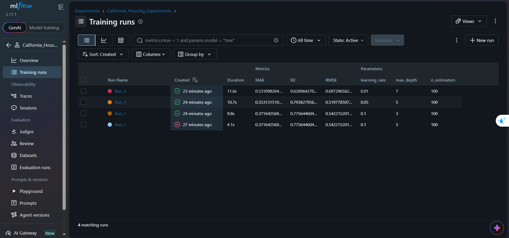

# MLflow Experiment Tracking

## Project Overview

This project tracks and compares three machine learning experiments for house price prediction using MLflow and the California Housing dataset.

## Dataset

The California Housing dataset is loaded using scikit-learn.

The dataset is split into 80% training data and 20% validation data using a fixed random seed of 42.

## Model

GradientBoostingRegressor is used for all three experiments with different hyperparameters.

## Parameters Tracked

- max_depth
- learning_rate

## Metrics Tracked

- RMSE
- MAE
- R2

## MLflow Experiment Results

The following screenshot shows the experiment results recorded in MLflow.



## Experiment Comparison

| Run | Max Depth | Learning Rate | RMSE | MAE | R2 |
|---|---:|---:|---:|---:|---:|
| Run 1 | 3 | 0.1 | 0.5422 | 0.3716 | 0.7756 |
| Run 2 | 5 | 0.05 | 0.5198 | 0.3531 | 0.7938 |
| Run 3 | 7 | 0.01 | 0.6973 | 0.5311 | 0.6290 |

## Best Model

Run 2 is the best-performing model among the three experiments.

It achieved the lowest RMSE of 0.5198, the lowest MAE of 0.3531, and the highest R2 score of 0.7938.

RMSE was used as the primary metric for model selection.

## How to Run

### 1. Install the Required Packages

```bash
pip install -r requirements.txt
```

### 2. Run the Training Script

```bash
python train.py
```

### 3. Start the MLflow UI

```bash
python -m mlflow ui
```

### 4. Open MLflow

Open the following URL in your browser:

http://127.0.0.1:5000

## Project Files

- train.py
- requirements.txt
- README.md
- mlflow-results.png
